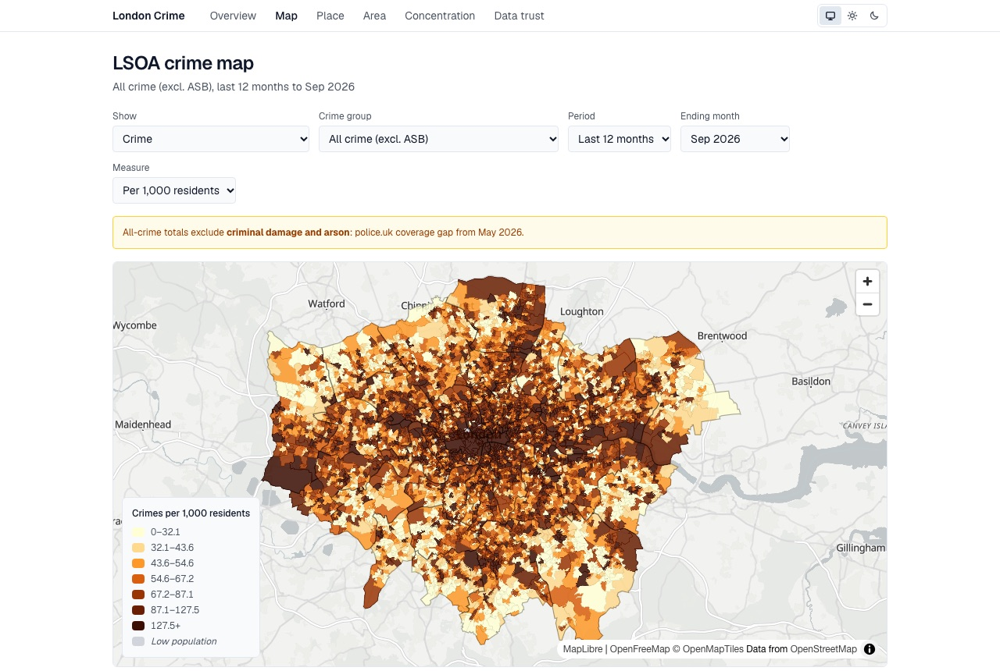
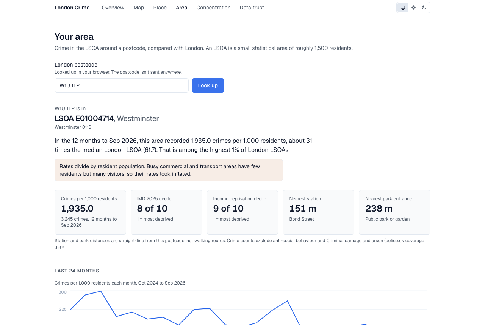
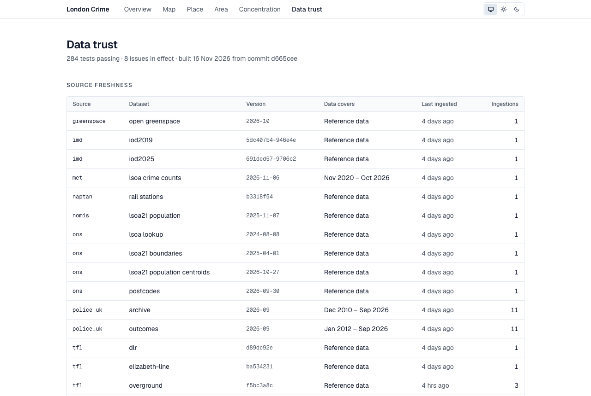

# London crime medallion

A pipeline and dashboard for crime in London, built on police.uk, ONS, Nomis, TfL and a few other open datasets. It downloads the raw files, cleans and models them with dbt and DuckDB, and publishes a static site that queries the data in your browser. There's also an MCP server, so an AI assistant can query the same data. Live at https://london-crime-medallion.pages.dev

<table>
  <tr>
    <td></td>
    <td></td>
  </tr>
  <tr>
    <td></td>
    <td></td>
  </tr>
</table>

## Try it

The site is at [london-crime-medallion.pages.dev](https://london-crime-medallion.pages.dev).

The MCP server reads the data from the live site, so nothing has to be built first. First [install uv](https://docs.astral.sh/uv/getting-started/installation/). It installs the server's two packages (and Python, if you don't have 3.11 or later) the first time the server runs. Then, from the repo root, add the server to Claude Code for all your projects:

```sh
claude mcp add --scope user london-crime -- uv run --script "$PWD/mcp_server/server.py"
claude mcp list
```

For Claude Desktop, add this to `claude_desktop_config.json` (on macOS, `~/Library/Application Support/Claude/claude_desktop_config.json`) with your absolute paths (`which uv` prints the first one), then restart Claude Desktop:

```json
{
  "mcpServers": {
    "london-crime": {
      "command": "/absolute/path/to/uv",
      "args": ["run", "--script", "/absolute/path/to/london-crime-medallion/mcp_server/server.py"]
    }
  }
}
```

To run the site locally without building anything you need Node 26. `npm run dev` reads the live site's data, as set in [web/.env.development](web/.env.development):

```sh
npm ci --prefix web && (cd web && npm run dev)
```

To use your own export instead, see the last step under Run the pipeline.

## The site

The overview has the London rate, monthly trend and crime group mix. The map is an LSOA choropleth for any crime group, the last 12 months or any year from 2011 to 2025, with layers for income, deprivation, distance to a station or park entrance, park area and park sites within 1 km. The place page bins crime rate against those same measures with Spearman correlations, and says they are correlations. The area page takes a postcode and shows its LSOA's rate against the London median, a 24-month trend and the crime mix. There are also pages for outcomes and concentration. The trust page shows source freshness, the police.uk against Met reconciliation, the known issues register, dbt test results and lineage, all read from the same export.

## How it fits together

Ingestion is TypeScript in [ingestion/](ingestion/). Each source downloads, checks a hash or row count, and lands raw Parquet in `data/bronze/<source>/` with a `_manifest.json`.

I keep every Met datastore release in bronze instead of only the newest. The datastore only offers a rolling window of about six years (the November 2026 release starts at November 2020), so old months would otherwise disappear.

The police.uk backfill reads ten archives (two from 2017, then one each September) plus the latest one. I started with four. Each archive only carries outcomes for crimes inside its own 36-month window, so with four archives some outcome months sat near the start of every archive that had them, and those months were missing outcomes for older crimes. My first outcome table made it worse by taking each month from the newest archive, which is where that month is thinnest. Now every outcome month sits at least 24 months into some archive, and outcomes are deduplicated per event (force, crime ID, month, outcome type) across all archives.

The dbt project in [transform/](transform/) has 59 models, 9 seeds and 284 tests. Silver maps police.uk crime types onto ten stable crime groups (police.uk renamed and split categories in 2011 and 2013), and gives every crime a 2021 LSOA. Gold has the facts the site reads: LSOA, borough and London by month with rates per 1,000 residents, charge rates, outcome mix, map points, concentration curves, and the reports behind the trust page. Boroughs roll up from the LSOA tables. My first version cut the borough out of the LSOA name with a regex, which only worked because of how ONS happens to name LSOAs, so I dropped it.

[export/export_web.py](export/export_web.py) writes the gold tables to Parquet with an `index.json` of sha256 hashes. It fails if the export goes over 150 MB in total or 8 MB for one file, because the browser downloads these files. The current export is 38 MB.

## Run the pipeline

The pipeline is heavy, and the site and the MCP server don't need it: both read the live site's data.

You need Node 26 and Python 3.14. Run everything from the repo root. Runner times are from the successful [refresh.yml](.github/workflows/refresh.yml) runs on GitHub Actions between 12 and 16 November 2026 (`gh run list --workflow refresh.yml`).

1. `npm ci --prefix ingestion && npm ci --prefix web && python3.14 -m venv .venv && .venv/bin/pip install -r transform/requirements.txt` installs the Node and Python packages.
2. `(cd ingestion && npm run check:sources)` asks every upstream source whether it is reachable, without downloading anything. It took 24 to 27 seconds in the four runner runs that had this step.
3. `(cd ingestion && npm run ingest)` fills `data/bronze/`. The first run downloads eleven police.uk archives one at a time, keeps the London rows and deletes each archive, then fetches the other sources. Bronze ends up at 2.6 GB. Later runs only fetch what changed. With bronze restored from the cache, ingest took 20 to 37 seconds in 12 of 13 runner runs and 113 seconds in the other.
4. `(cd transform && ../.venv/bin/dbt deps && ../.venv/bin/dbt build --profiles-dir . --threads 2)` builds and tests every model into `data/warehouse.duckdb`, which is 8.4 GB on my Mac. On my Mac, a full build at the 4 threads set in [profiles.yml](transform/profiles.yml) filled the temp disk (DuckDB used 17.4 GiB of temp files), and the same build with `--threads 2` passed. On the runner, `dbt deps` and the build took 6.2 and 9.5 minutes in the two runs since it moved to two threads. The profile caps DuckDB at 4 GB of memory.
5. `.venv/bin/python export/export_web.py` writes the gold tables to `data/export/`. It took 7 to 17 seconds on the runner and writes 244 files, 38 MB.
6. `.venv/bin/python mcp_server/smoke_test.py` starts the MCP server and calls every tool once. It reads the live site, not your export, because the MCP client doesn't pass `LONDON_CRIME_DATA` through to the server.
7. `ln -sfn ../../data/export web/public/data && echo 'NEXT_PUBLIC_DATA_BASE_URL=/data' > web/.env.local && (cd web && npm run dev)` serves the site from your export. `web/.env.local` overrides the live data URL in `web/.env.development`. It keeps running until you stop it, so it goes last.

## LSOAs

police.uk gives each crime an LSOA code, but older rows use 2011 codes and some have none. I use the police.uk code when it is already a London 2021 LSOA (15.9 million rows) and otherwise drop the point into the 2021 boundaries with DuckDB's spatial extension (1.1 million rows). About 209,000 rows have no location inside a London LSOA and are left out of the LSOA tables.

The boundaries are the full-resolution BFE set. I used the generalised BGC set until ONS made that service private in November 2026 and the ingest started failing. The population-weighted centroids layer started asking for a token too. After the second one I added `npm run check:sources`, which queries every upstream source before ingest and prints a search hint when an ArcGIS layer has moved.

## Things that went wrong

The doubled ASB months. I added tests that fail when a crime group's monthly count jumps or collapses against its neighbours, with a seed of breaks I've explained (lockdown in April 2020, the 2011 and 2013 category changes). The spike test failed on Met anti-social behaviour for March and October 2022: 35,180 and 36,524 rows, against 15,400 to 18,300 in the months either side. police.uk had published those months twice. The fix keeps half of each group of identical rows, only for the months listed in a seed. My first version of the fix ignored force, so it also applied to City of London ASB in those months. After the fix the two months read 17,590 and 18,262.

The collapsed criminal damage numbers. The reconciliation report compares police.uk with the Met datastore by borough, month and crime group. Leaving out the City of London, where the datastore has almost no rows, police.uk is 0.87% above the datastore in total from November 2020 to April 2026, though some groups differ by more (see What I found). Between April and May 2026 police.uk Met criminal damage and arson dropped from 4,309 rows to 222 and has stayed around 200 to 250 a month, while the datastore still shows about 4,600. Borough by borough police.uk is 93% to 98% short. Crime didn't fall, since the datastore shows no drop. Where the missing records went is less clear.

From May to September 2026 police.uk is short about 4,400 Met criminal damage records a month. Over the same months police.uk violence ran about 630 a month further above the datastore than it did from January to April 2026, which could be some of them recorded under another group. ASB didn't rise: May to September 2026 was 3% lower than a year earlier. Across all the other groups the net change on the same comparison is about 500 a month, so most of the missing records don't show up anywhere in police.uk. I don't know where the rest went. I registered it in [known_crime_gaps.csv](transform/seeds/known_crime_gaps.csv), and a test fails if the reconciliation shows a gap like this that isn't registered.

The headline that disagreed with itself. After the criminal damage gap, the year-on-year changes on the overview left the group out, but the headline rate didn't. So the overview said London was at 97.8 crimes per 1,000 and the MCP server said 94.3. Both were computed correctly, they just counted different things, and nothing on the page said so. I changed the headline to leave out coverage gap groups too, and the dbt metric descriptions now say that the semantic layer includes them.

Results that depended on row order. Some crime IDs have several offence rows, and I picked the crime's group, LSOA and borough from the earliest one. Ties within a month fell back on `record_id`, which changes whenever bronze is rewritten. Shuffling the input changed the group, LSOA or borough of some crime IDs. Ties now break on an md5 of the row's content. I fixed the same kind of tie in the nearest station, nearest park and source freshness picks.

Met outcome data. From October 2017 the Met's outcome volume drifts down from about 50,000 a month, and from April 2019 to April 2020 it falls to about 6,600 to 10,200. Then backlogs of about 127,000 and 161,000 outcomes arrive in March and April 2020, dated by when they were recorded. I found it with the same collapse test run on outcomes. These periods are in [known_outcome_gaps.csv](transform/seeds/known_outcome_gaps.csv) with a severity, and any crime whose 12-month follow-up overlaps a degraded or collapsed period is flagged as impaired.

A manual run of the refresh workflow failed in the dbt build when the runner ran out of disk. Rerunning the same commit passed, so I haven't proven the cause. DuckDB spills to a temp file next to the warehouse, so I cut the CI build to two dbt threads and delete more preinstalled toolchains before it starts. I haven't run it enough times since to call it fixed.

## Decisions

Anti-social behaviour is never in the rates. The LSOA tables count it in a separate `asb_count` column next to `crime_count`, and the charge rate leaves it out because it has no crime ID.

A crime group with a registered coverage gap is left out of any rate whose window overlaps the gap. Today that is criminal damage and arson from May 2026. The police.uk counts aren't filled in from the Met datastore. Datastore figures only feed the Met fact tables, the reconciliation report and source freshness. The map disables the group for periods that overlap the gap, and the concentration figures leave it out in every year so 2026 can be added without the undercount.

The charge rate is the share of crimes charged within 12 months, and a month only gets a value once it has had 12 months of follow-up. A plain charged-ever rate falls off at the right edge because recent crimes haven't had time to be charged, which looks like a drop that isn't real. Unfinished months are null, not low. Only police-stage outcomes count, because police.uk stopped publishing court outcomes after May 2019. The series starts in 2012 because crime IDs start in December 2011.

Rates are crimes over the window divided by residents in the window's last month, times 1,000. LSOAs with fewer than 1,000 residents are flagged. LSOAs were drawn for at least 1,000 people, and below that a few crimes swing the rate a lot.

The site has no backend. Next.js builds a static export, and DuckDB-wasm in the browser queries the Parquet files directly. I self-host the wasm files so the site makes no requests to jsDelivr or duckdb.org. The export is deterministic (fixed row order, single-threaded writes, rounded derived floats, sorted JSON), so the same warehouse gives the same hashes, and CI skips the deploy when nothing changed.

## What I found

Half of London's recorded crime in 2025 (leaving out ASB and criminal damage) was in 17% of LSOAs and 11% of police.uk map points. police.uk never publishes a map point with no crime, so places with no crime aren't in the point denominator. The point curve skips 2011 and 2022 because police.uk replaced its set of anonymous map points in December 2011 and July 2022.

Concentration rose after 2020. The LSOA Gini went from 0.39 in 2020 to 0.49 in 2024, and the share of LSOAs holding half of crime went from 23% to 16%.

Of Met and City of London crimes from October 2024 to September 2025, 5.7% were charged within 12 months. It counts police-stage outcomes only and leaves out ASB, which has no crime ID. Those are the latest crime months that have each had 12 months of follow-up.

From November 2020 to April 2026, before the criminal damage gap, five of the nine crime groups in police.uk are within 1.5% of the Met datastore. Robbery is 2% lower, other crime 4% lower and drugs 6% lower in police.uk, and violence is 7% higher.

On the place page, for the 12 months to September 2026, the Spearman correlations between an LSOA's crime rate and each measure are: IMD 2025 decile -0.47, income deprivation decile -0.38, employment deprivation decile -0.38, distance to the nearest station -0.31, distance to the nearest park entrance -0.19 and park area within 1 km -0.03. The map's parks within 1 km layer gives 0.27 for the number of park sites within 1 km. Decile 1 is the most deprived, so a negative value means more deprived areas have higher rates.

## Limitations

LSOAs with fewer than 1,000 residents are flagged, and the place charts leave out the 6 that fall below it, because a few crimes swing their rates a lot.

police.uk and the Met datastore use different categories. I map both onto the same crime groups, but the Met's major categories don't line up exactly with police.uk crime types, so the reconciliation compares groups that are close, not identical.

The IMD has a crime domain, so part of the link between IMD and crime is crime compared with itself. Income and employment deprivation are the cleaner comparison.

The place correlations are correlations, not causes. They also treat every LSOA as independent, but neighbouring LSOAs are alike, so any p-value computed that way would be too optimistic.

Station and park distances are straight-line distances, not walking routes.

## MCP server

[mcp_server/](mcp_server/) is a read-only MCP server over the published Parquet, with the same exclusions as the site. Every answer carries its period, what was excluded and why, and the caveats.

- `list_metrics()`: metric definitions from the dbt semantic layer
- `crime_rate(borough, crime_group=None, months=12)`: crimes per 1,000 for a borough or London
- `crime_mix(borough=None, months=12)`: counts, shares and rates by crime group, compared with London
- `lookup_postcode(postcode)`: LSOA, borough, 12-month rate, deprivation deciles, nearest station and park
- `data_quality(topic=None)`: entries from the known issues register

By default it downloads the files it needs from the live site into a local cache checked against `index.json`. Reading straight from the URL also works, but Cloudflare Pages answers a Range request with a 200 and the whole file, so DuckDB downloads each file in full on every query. Set `LONDON_CRIME_DATA=data/export` to read a local export instead. With Claude Code, add `-e LONDON_CRIME_DATA=$PWD/data/export` before the `--` in the command under Try it.

## Refresh

[refresh.yml](.github/workflows/refresh.yml) runs on GitHub Actions at 04:00 UTC on days 1, 7, 13, 19, 25 and 31 of each month, roughly every six days. It restores bronze from the Actions cache, checks sources (a failure there is only a warning), ingests, runs `dbt build`, exports, and compares the export's hashes with the live `index.json`. It deploys to Cloudflare Pages only if a file changed. If ingest fails on a cold cache it stops before dbt, so the site is never built from partial bronze. The gaps are kept under seven days because Actions evicts a cache after seven days without use.

## Data sources and attribution

| Source | What I use | Licence | Attribution |
| --- | --- | --- | --- |
| [police.uk](https://data.police.uk/about/) | Street crimes and outcomes for the Met and City of London, December 2010 to September 2026 (17.3 million crime rows, 10 million outcome events) | [Open Government Licence v3.0](https://www.nationalarchives.gov.uk/doc/open-government-licence/version/3/) | "Contains public sector information licensed under the Open Government Licence v3.0." |
| Met Police via the [London Datastore](https://data.london.gov.uk/dataset/mps-recorded-crime-geographic-breakdown-exy3m) | Monthly crime counts by LSOA, used only to check police.uk | [Open Government Licence v2.0](https://www.nationalarchives.gov.uk/doc/open-government-licence/version/2/) | "Contains public sector information licensed under the Open Government Licence v2.0." The [London Datastore terms](https://data.london.gov.uk/about/terms-and-conditions/) also ask re-users to say that the GLA cannot warrant the data (see below) |
| [ONS Open Geography](https://www.ons.gov.uk/methodology/geography/licences): boundaries and centroids | 2021 LSOA boundaries (BFE) and population-weighted centroids | [Open Government Licence v3.0](https://www.nationalarchives.gov.uk/doc/open-government-licence/version/3/) | "Source: Office for National Statistics licensed under the Open Government Licence v.3.0" and "Contains OS data © Crown copyright and database right 2026" |
| [ONS Open Geography](https://www.ons.gov.uk/methodology/geography/licences): lookup | 2011 to 2021 LSOA lookup | [Open Government Licence v3.0](https://www.nationalarchives.gov.uk/doc/open-government-licence/version/3/) | "Source: Office for National Statistics licensed under the Open Government Licence v.3.0" |
| [ONS Postcode Directory](https://www.ons.gov.uk/methodology/geography/licences) | London postcodes with their LSOA and coordinates | [Open Government Licence v3.0](https://www.nationalarchives.gov.uk/doc/open-government-licence/version/3/) | "Contains OS data © Crown copyright and database right 2026", "Contains Royal Mail data © Royal Mail copyright and database right 2026" and "Source: Office for National Statistics licensed under the Open Government Licence v.3.0" |
| [Nomis](https://www.nomisweb.co.uk/home/copyright.asp) | Yearly population estimates by 2021 LSOA | Open Government Licence | "Source: Office for National Statistics" |
| MHCLG [IMD 2019](https://www.gov.uk/government/statistics/english-indices-of-deprivation-2019) and [IMD 2025](https://www.gov.uk/government/statistics/english-indices-of-deprivation-2025) | Index of Multiple Deprivation by LSOA | [Open Government Licence v3.0](https://www.nationalarchives.gov.uk/doc/open-government-licence/version/3/) | "Contains public sector information licensed under the Open Government Licence v3.0." |
| [TfL open data](https://tfl.gov.uk/corporate/terms-and-conditions/transport-data-service) | Tube, Overground, DLR, Elizabeth line and tram stations | Transport Data Service licence, based on version 2.0 of the [Open Government Licence](https://www.nationalarchives.gov.uk/doc/open-government-licence/version/2/) with amendments by TfL | "Powered by TfL Open Data", "Contains OS data © Crown copyright and database rights 2016" and "Geomni UK Map data © and database rights [2019]" |
| [NaPTAN](https://www.data.gov.uk/dataset/ff93ffc1-6656-47d8-9155-85ea0b8f2251/national-public-transport-access-nodes-naptan) (Department for Transport) | National Rail stations that TfL doesn't list | Open Government Licence | "Contains public sector information licensed under the Open Government Licence v3.0." |
| [OS Open Greenspace](https://www.ordnancesurvey.co.uk/customers/public-sector/public-sector-licensing/copyright-acknowledgments) | Park sites and their entrances | Open Government Licence (OS OpenData) | "Contains OS data © Crown copyright and database right 2026" |
| [OpenFreeMap](https://openfreemap.org/) | Basemap tiles on the map page | Attribution required | "OpenFreeMap © OpenMapTiles Data from OpenStreetMap", shown by MapLibre on the map |
| [OpenStreetMap](https://www.openstreetmap.org/copyright) | Map data in the basemap | [Open Database License](https://www.openstreetmap.org/copyright) | "© OpenStreetMap contributors" |

The Greater London Authority cannot warrant the quality or accuracy of the data from the London Datastore, and nothing here is endorsed by the GLA.

## Licence

MIT, see [LICENSE](LICENSE).
